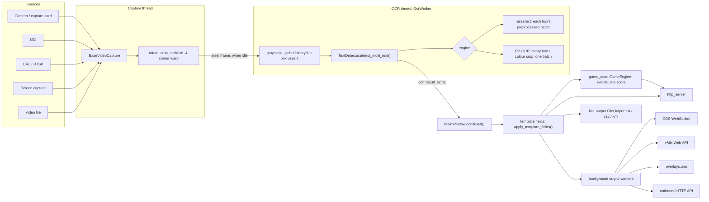

# Architecture
{: .no_toc }

  
On this page

  {: .text-delta }
1. TOC
{:toc}

## Overview

All application code is a flat set of modules in `src/` that import each other by bare module name (`from storage import fetch_data`), not as a package. Running `python src/main.py` puts `src/` on `sys.path`. The test configuration (`pythonpath = ["src", "."]` in `pyproject.toml`) does the same for pytest, and also puts the repository root on the path for the OCR evaluation harness, the `ocr_eval` package (see [OCR Evaluation](ocr-eval.md)).

## Frame → OCR → outputs pipeline

1. **Source discovery**: `get_camera_info.py` enumerates devices per OS (a DirectShow extension in `src/win32DeviceEnum` on Windows, AVFoundation on macOS, `/dev/video*` capture nodes via V4L2 on Linux) plus NDI sources (`ndi.py`, via cyndilib) into `CameraInfo` objects. `CameraInfo.CameraType` distinguishes OpenCV devices, NDI, files, URLs and screen capture. `MainWindow` runs the discovery on a worker thread (`mainwindow.run_in_background`) and gets the result back through a signal, so the window appears immediately. The startup OBS connection and the update check run the same way.
2. **Capture thread**: `source_view.ImageViewer` extends `camera_view.CameraView` (a `QGraphicsView`), which owns a `camera_thread.TimerThread` (a `QThread`). The thread chooses a `BaseVideoCapture` implementation:
   - `OpenCVVideoCaptureWithSettings` for cameras (with the stored Video Settings applied at open; DirectShow is the default backend on Windows, and a stored backend that can't open the device falls back to the default one), files, and URLs (FFmpeg, with 5 s open/read timeouts and `OPENCV_FFMPEG_CAPTURE_OPTIONS` defaulting to `rtsp_flags;prefer_tcp`: RTSP over TCP first, falling back to UDP, which is also OpenCV's behaviour when the variable is unset),
   - `ndi.NDICapture` for NDI,
   - `screen_capture_source.ScreenCapture`, which resolves to the macOS or Windows implementation, or a dummy on Linux.

   Closing a viewer disconnects the thread's signals, unsubscribes it from storage and waits at most 3 s (`STOP_TIMEOUT_MS`) before letting it finish in the background. An `atexit` handler gives threads still running at exit a bounded wait.

   The thread records the source's own frame rate (`nominal_fps`, from `CAP_PROP_FPS` when the source reports one) and its failed reads (`retry_count`); `status_bar.source_state()` turns them, the last frame's time and the frame rate into the source's state (running, slow, stalled, reconnecting, failed), which the dot before the source and the status bar show. A source failure (`update_error`) raises the main window's source banner (`updateSourceBanner`, the texts in `source_bar.py`); `CameraView.show_error_text` is only for messages that aren't source failures.
3. **Per-frame processing**: `TimerThread.run()` reads frames and `process_frame()` transforms them: rotate and crop (`FrameCropAndRotation`) → optional stabilization (`frame_stabilizer.py`, ORB features + affine warp) (`adjust_frame`) → optional perspective homography from the user's four corners (`correct_frame`; while new corners are picked, `preview_uncorrected` makes the preview skip it, but the OCR still reads the corrected picture, until `ImageViewer` applies the new corners on the 4th valid click) → grayscale (plus a global Otsu binary, computed only when a box uses Global binarization) → `TextDetector.detect_multi_text()` (with the colour frame too, for PP-OCR). The loop reads frames at up to ~33 fps, runs OCR at the "detection cadence" (Detections / s, clamped to at least 0.1/s), and emits a preview frame about once per second, independently of the cadence. While the capture runs, the OCR runs on its own thread (`camera_thread.OcrWorker`, started and stopped by `run()`), so a slow OCR cycle never stops the loop from reading frames: a live source's frames don't go stale in its buffer and a file plays at the loop's rate. `process_frame` hands the worker a frame only when it is idle (no frame waiting, none being read), so the OCR always reads the latest frame and the frames read meanwhile are dropped (they may still be previewed); the worker's `run_ocr_cycle()` snapshots the boxes, runs the OCR and publishes the results as before. Without a running capture (the tests call `process_frame` directly) the OCR runs inline. `last_reading_latency` and `reading_latency` record the time from reading a frame to publishing its readings. Timing uses `time.monotonic()`. A per-frame error is logged and shown in the view (at most every 5 s, through `processing_error`, which doesn't disable the view tools the way a failed source's `update_error` does) and the loop keeps running.
4. **OCR** (`tesseract.py`, `ppocr_engine.py`, `ocr_models.py`): `TextDetector` reads with one of two engines, chosen by the OCR model (`ocr_models.py` maps the stored `ocr_model` to them: `"ppocr:auto"`, `"ppocr:small"`, `"ppocr:tiny"`, the Tesseract indexes 0–3 or a `.traineddata` path; nothing stored is a new setup, whose default is `"ppocr:auto"`, and a PP-OCR model that can't be used reads with Tesseract's General Scoreboard without being stored). Both engines' readings go through the same post-filters (`_finish_reading`), so they produce the same `TextDetectionResult`s and the rest of the app doesn't know which engine read.

   **PP-OCR** (`ppocr_engine.py`): PaddleOCR's PP-OCRv6 recognition models (small: "accurate", tiny: "fast") on onnxruntime, from `ocr_models/ppocr/` (downloaded by `scripts/fetch_models.py`). onnxruntime is imported and a model loaded on a background thread when it is first chosen (`Recognizer.start_loading`; recognizers are shared per process), so neither the window nor the capture waits; until it is ready the boxes are `Empty`, and if it fails `TextDetector` loads a Tesseract fallback and says so (`EngineStatus`, shown in the status bar). PP-OCR boxes skip the Tesseract preprocessing: each box's colour crop (the frame after the picture adjustments) is batched with the frame's other boxes into one `session.run` per padded width, resized to 48 px high and padded to at least 320 px (PaddleOCR's preprocessing), and CTC-decoded greedily with only the box's `FieldType` characters allowed (NFKC-equal characters grouped); the confidence is the kept characters' mean probability, compared with the box's threshold in percent. Boxes with almost no contrast are `Empty` (`has_contrast`: under 30 gray levels between the crop's 2nd and 98th percentiles; every labelled evaluation crop has 37 or more), skip-similar compares the crop thresholded on its own (`similarity_patch`), and a dot counter is counted on its preprocessed patch as with Tesseract. Sessions use 2 intra-op threads without spinning (`SCORESIGHT_PPOCR_THREADS`). PP-OCR (automatic) is an `AutoChooser`: it reads with small while a frame's batch takes it under 70% of the time between detections (`TextDetector.cycle_interval_ms`, set by the capture thread), switches to tiny after 3 s over, and back when small, from its measured cost per box, would need under 50% for 10 s; its status (`EngineStatus.auto_*`) is shown in the model list and the status bar. `ocr_eval/engines/ppocr_scoresight.py` measures this engine end to end in the [OCR evaluation](ocr-eval.md).

   **Tesseract**: `TextDetector` holds a single `tesserocr.PyTessBaseAPI`, using PSM 8 (single word) and the models in `tesseract/tessdata/*.traineddata`. The whole Tesseract sequence for a box runs under one lock, and a model change builds the new API outside the lock and swaps it in (the lock also guards the PP-OCR choice). For each box it clamps the box to the frame (without changing the stored box), preprocesses its own copy of the patch (`preprocess_patch`: binarization, cleanup, vscale, skew, dilate; the same function renders Binary View), inverts, returns `Empty` for a blank patch (`0` for a dot counter), applies skip-similar (against the patch of the box's last `Success` read), autocrop, rescale and W/H normalization, then runs the dot counter or OCR with a character whitelist from the `FieldType`, and post-filters the text (format regex, confidence threshold against Tesseract's 0–100 confidence, whole-string smoothing, leading zeros, ordinal suffix). Results are `TextDetectionResult` objects, which `TimerThread` wraps into `TextDetectionTargetWithResult` (publishing a box skipped by skip-similar, and with "update on change" a repeated reading, as `SameNoChange`: the box's last good reading) and emits through `ocr_result_signal`.
5. **Fan-out** (`MainWindow.ocrResult` in `mainwindow.py`, on the GUI thread):
   - applies the held values (**Hold value**): `held_values.HeldValues.apply(results)` replaces each held field's result with a copy carrying the value typed in (`Success` once, then `SameNoChange`; a held template field isn't evaluated) and makes a released field's next good reading a `Success` (`finish_released()` for template fields, after they are evaluated). Templates and every output see the held values; the capture thread doesn't know about them, so the OCR goes on unchanged. Held values are not persisted,
   - holds back implausible changes (**plausibility holds**, with a sport chosen; issue #97): `GameEngine.held_back(results)` names the good readings the game isn't counting yet (a change the sport doesn't allow, not read steadily for 3 s; Hold value and template fields are skipped), and `plausibility_holds.PlausibilityHolds.apply(results, held_back)` replaces each with the last good value sent (`SameNoChange`), makes the field's next good reading after the hold a `Success`, and logs each hold (why, then sent or dropped). The game itself is then fed the results from before this step,
   - evaluates template fields: `template_fields.apply_template_fields(results)` sets each template's text from the last good readings and its state (`Success`, `SameNoChange` or `Empty`),
   - follows the game (with a sport chosen): `game_state.GameEngine.update(results)` reads the roles of the boxes (`sports.assign_roles`, by name), counts a changed value once it is read again (a change the sport doesn't allow once it is read steadily for 3 s), and returns the events (score, period start and end, clock start and stop, fouls, timeouts, final; in a lap race lap, final lap, finish and new race), which `game_ui_handler` logs; its `state()` (the line score and the event log too) goes to `http_server.update_game_state` for `/game` with the other outputs. It sees the held values and the readings themselves (not the plausibility holds) and runs while the outputs are paused,
   - updates the field table: every OCR reading (not the held values) is stored in its box's Value item (`readings_view.record_reading`: the last good text, the state, the time of the last good reading, a rejected text; `set_held` adds the held value), which `readings_view.ReadingDelegate` paints,
   - publishes to `http_server.update_http_server` (which snapshots the results), the outbound API (`api_output.update_out_api`), the vMix and UNO updaters (owned by `vmix_ui_handler` / `uno_ui_handler`), the TCP / UDP output (`tcp_output.TcpOutput`, owned by `tcp_ui_handler`), OBS text sources (`obs_websocket.update_text_source`, for good values that changed) and `file_output.FileOutput` (txt/csv/xml).
   - Network outputs hand their payload to background workers (`output_worker.OutputWorker`, one daemon thread per output) that coalesce pending items per key (latest value wins), use request timeouts, back off while the target is unreachable and throttle their error logging, so the GUI thread never blocks on I/O.
   - File output is state-based and atomic: `FileOutput.record()` remembers every box's last good reading, and `flush()` (at most **Save / s** times per second, with a `QTimer` for the pending change) writes only files whose content changed or that are missing.

`mainwindow.py` is the central hub. It wires the UI, sources, the OBS connection, import/export and language/appearance switching. The window is three panes in `splitter_main`: the Fields pane (`tableWidget_boxes` with its header, footer buttons, context menu and keys), the viewer column (`frame_source_view`: the source bar with the view tools, the Adjust picture row, the source error, 4-corner and paused banners, and the viewer or the first-run card) and the Inspector (`tabWidget_inspector`: the **Box** tab with the selected field's settings and **All boxes**, the **Outputs** tab with the destinations). The side panes can be hidden; their widths are saved as `main_splitter_sizes`. **View > Setup layout / Live layout** (`setLayoutMode`, saved as `window_layout`) arrange the same widgets for setting up or for the game: Live hides the Inspector, the Adjust picture row and the field footer, makes the field list about 400 px wide (`live_fields_width`) with large readings (`ReadingDelegate.setDensity`), hides the fields not on the picture (View > Show unused fields, per layout) and shows the outputs under the readings (`listView_liveDestinations`: the same `DestinationsModel` with `CompactDestinationDelegate`). Setup restores `main_splitter_sizes`. While **Pause outputs** is on, `ocrResult` still updates the field table but returns before the outputs; on resume, vMix and UNO also get each box's next good reading when it is unchanged (`resend_unchanged`, the boxes in `resendAfterPause`). A 1-second timer refreshes the outputs' statuses, the status bar (`status_bar.MainStatusBar`, from a `StatusSnapshot` of what the window already knows: the capture thread's counters, the pause, `get_http_server_port()`, the outputs), the source's health dot, the first-run card's steps and the readings' ages. Texts set at runtime (the pause button and banner, slider readouts, the Box tab's notes, badge and format message, the status bar, the OBS buttons, the destinations' names, the Appearance items, shortcut hints in tooltips, the open source's name, the rotation, the zoom readout, the banners and the first-run card) are set again by `applyRuntimeTexts()` after `retranslateUi` on a language change; state that `retranslateUi` doesn't touch (the selected field and tab, the open Image cleanup section, the footer buttons) stays as it was.

### Output status

The **Outputs** list (`listView_destinations`, with `destinations_view.DestinationsModel` and `DestinationDelegate`), in the Inspector's Outputs tab, has a row per output over `stackedWidget_outputs` (a vertical `splitter_outputs` divides them), whose pages are the output settings (the old tabs, with their objectNames; the TCP / UDP output's page, `tab_tcp`, is its own Designer form, `tcp_output.ui`, which `tcp_ui_handler.TcpUIHandler` adds as the last page). Once a second (and when an output is switched), `MainWindow.destinationStatuses()` builds a `output_status.DestinationStatus` for every output from cheap, thread-safe snapshots, never from the network:

- `OutputWorker.status()`: a `WorkerStatus` taken under the worker's lock: items sent and failed, consecutive failures, whether the endpoint is being retried (and the backoff), the keys whose latest item was sent or dropped, the last success and failure times, and the last error as an `ErrorInfo` (the exception's type, message and HTTP status or OBS code, without the exception object). `reset_status()` starts over when an output is stopped or sends somewhere else; `forget_keys()` drops a closed OBS connection's text sources. A send function raises `SendSkipped` for an item it deliberately didn't send.
- `http_server.http_server_stats()`: a request counter (an ASGI middleware), the time of the last request, the clients seen in the last 10 s, and why the server couldn't start.
- `FileOutput.status()`: the folder, the files written, the last write, and the files whose last write failed (GUI thread only, like `FileOutput`).
- the OBS client, the attempt running and why the last one failed (`obs_websocket.last_connect_error()`, recorded on the connecting thread).
- `TcpOutput.connection_status()`: whether the TCP connection is open or being opened, and the receiver's last answer (an AMCP-style answer with a 4xx/5xx code is an error until a 2xx one), written by its worker and reader threads under a lock.

`output_status.describe_error()` turns a failure into a short line and what to do, for the documented cases (vMix's TCP API port, HTTP 401/403/404/429/5xx per output, refused, timed-out or unknown hosts, OBS password and missing-source errors). Secrets are redacted (`url_secrets`, `redact`). The switches never change an output themselves: `DestinationsModel.setData(CheckStateRole)` emits `toggleRequested`, and `MainWindow.destinationToggleRequested` operates the output's own control, which stays the source of truth.

## HTTP server

`http_server.py` runs a FastAPI app under uvicorn in a daemon thread, bound to `0.0.0.0` (IPv4) on the port given by `--port` (default 18099). The API is `start_http_server(port)`, `stop_http_server(timeout)`, `update_http_server(results)` and `get_http_server_port()` (the running port, or `None`). `start_http_server` binds the socket itself (exclusively on Windows), logs and returns if the port is busy, and accepts port 0 for a free port. The server is stopped in-process (uvicorn's `should_exit`, then `force_exit`, with a bounded join) when the app quits, and `stop_http_server` never touches another process's server. There is no HTTP shutdown endpoint. See the [HTTP Server API](../http_server.md) for the public endpoints.

## Detection boxes and their settings

- `TextDetectionTarget` (in `text_detection_target.py`) subclasses `QRectF` and adds a `name`, a `settings` dict and optional `mini_rects`.
- All boxes live in `storage.TextDetectionTargetMemoryStorage`, a singleton `QObject` whose `data_changed` signal drives both the field table and the viewer overlay (`resizable_rect.py`).
- The standard boxes and the format presets are defined in `defaults.py`. Every other name is a custom box.

**Adding a new per-box setting** requires changes in several places:

1. `defaults.normalize_settings_dict`: the canonical key and its default. Nothing needs to change in `storage.py`: `TextDetectionTargetMemoryStorage.getBoxesForStorage` saves exactly what `normalize_settings_dict` returns (`tests/test_storage.py` checks this).
2. `box_settings_ui_handler.py` (connect it, set it in `populateSettings`, and add it to `settingsWidgets()`; an Image cleanup setting also goes in `IMAGE_CLEANUP_SETTINGS`, which the section's "changed" badge counts), plus the widget in its section of the Box tab in `src/mainwindow.ui` (then regenerate the UI, see [Building from Source](building.md#compile-the-ui-files)).
3. `tesseract.py`, if the setting affects processing.
4. `docs/box-settings.md`, so users know what it does.

If the meaning of a stored value changes, bump `storage.BOXES_SCHEMA_VERSION` and extend `storage.migrate_boxes`, which migrates boxes saved by older versions once when they are loaded.

## Persistence and settings pub/sub

`storage.py` keeps app state as named documents in a JSON file in the user data directory (`platformdirs.user_data_dir("scoresight")`, overridable with `SCORESIGHT_DATA_DIR`). The file is `scoresight.json`, or `scoresight-<profile>.json` with `--profile` / `SCORESIGHT_PROFILE`.

- `store_data(file, key, value)`, `fetch_data(file, key, default)` and `remove_data(file, key)` read and write documents. Writes are atomic (temporary file + `os.replace`) and thread-safe. A corrupt file is backed up as `<name>.corrupt-<timestamp>` instead of being overwritten silently.
- `subscribe_to_data(file, key, callback)` registers a callback that runs after a successful `store_data` of that key, **synchronously, on whichever thread stored the value**. `unsubscribe_from_data(file, key, callback)` removes it. Components that are created and destroyed (captures, threads, output updaters) must unsubscribe, or they stay alive through the callback list.
- Many components read their settings once at construction and then stay current through subscriptions.
- `MainWindow` loads the boxes once at startup and saves them 500 ms after the last change (`BOXES_SAVE_DELAY_MS`), so switching sources never reloads stale boxes from disk.
- One-time migrations are recorded in the settings file itself: `vmix_port_migrated` (a stored vMix port 8099 becomes 8088) and `boxes_schema_version` (2: boxes saved before 0.2.0 get `conf_thresh` 0, because the threshold had no effect before the confidence-scale fix; 3: a box whose format is the two-digit Time 0-59 or Shotclock 0-39 expression of 0.3.0 and older gets the preset's one- or two-digit expression, `storage.TWO_DIGIT_FORMATS`).

Logging goes through `from sc_logging import logger`. It writes to `platformdirs.user_log_dir("scoresight")` (overridable with `SCORESIGHT_LOG_DIR`) and keeps the most recent log files. `SCORESIGHT_DEBUG` mirrors the log to the console.

## Versioning and resources

- `src/version.py` (`__version__`) is the single source of truth for the version: the window title, About dialog, update check, PyInstaller spec, installer and release workflow all read it.
- `resource_path(...)` (`src/resource_path.py`) resolves bundled resources (`tesseract/`, `translations/`, `icons/`, `obs_data/`). When frozen, it uses PyInstaller's `sys._MEIPASS`. From source, it resolves against the repository root, so `python src/main.py` works from any working directory.

## Module map

| Module | Responsibility |
|---|---|
| `main.py` | Entry point: CLI options (`--profile`, `--port`, `--self-test`), QApplication, translation, appearance, main window |
| `mainwindow.py` | Main window: UI wiring, sources, outputs fan-out, OBS connection, import/export, menus, the Setup and Live layouts, Hold value |
| `version.py` | `__version__` |
| `defaults.py` | Field types, format presets, standard boxes, `normalize_settings_dict` |
| `storage.py` | JSON settings storage, pub/sub, box storage singleton |
| `sc_logging.py` | Logger setup and log rotation |
| `resource_path.py` | Locating bundled resources (frozen or from source) |
| `camera_info.py`, `get_camera_info.py` | Source descriptions and device enumeration |
| `base_video_capture.py` | Common capture interface |
| `camera_thread.py` | Capture + processing loop (`TimerThread`), the OCR thread (`OcrWorker`), OpenCV capture with settings, crop/rotation |
| `camera_view.py`, `source_view.py` | Viewer widgets: preview, statistics overlay, zoom/pan, guarded 4-corner picking, arrow-key nudging, placing the boxes' labels |
| `resizable_rect.py` | Interactive box items (move, resize, halo strokes, per-character sub-boxes) and their fixed-size label pills (`BoxLabel`, placed by `place_label`) |
| `source_bar.py` | The viewer column's texts (the open source's name, source errors, the 4-corner banner, zoom, rotation), the macOS screen recording check, and `CompactToolRow` (icon-only tool buttons in a narrow window) |
| `frame_stabilizer.py` | ORB-based frame stabilization |
| `ndi.py` | NDI discovery and capture (cyndilib) |
| `screen_capture_source*.py` | Screen/window capture for macOS and Windows (dummy on Linux) |
| `video_settings.py` | Video Settings dialog (FPS, resolution, FOURCC, backend) |
| `tesseract.py` | `TextDetector`: reads the boxes with the chosen engine (Tesseract's preprocessing and OCR, or PP-OCR), the post-filters, `EngineStatus` |
| `ppocr_engine.py` | The PP-OCR engine: PP-OCRv6 recognition on onnxruntime (lazy, batched, whitelist-constrained CTC decoding), PP-OCR (automatic)'s `AutoChooser` |
| `ocr_models.py` | The OCR model choices and how `ocr_model` is stored (the default for a new setup, the fallback when PP-OCR can't be used) |
| `text_detection_target.py` | Box and result types, per-character smoother |
| `template_fields.py` | `{{Box Name}}` template evaluation |
| `box_settings_ui_handler.py` | The Inspector's Box tab: shows the selected field (a box, a field not on the picture, a template) and binds its settings, the sliders' readouts, the matching Format preset and invalid expressions, Image cleanup's changed badge and Insert field |
| `readings_view.py` | The field table's Value column: the readings' data roles and `ReadingDelegate` (Setup and Live densities, a held value's HELD chip and Release button) |
| `held_values.py` | Hold value: `HeldValues` (what the outputs get while a field is held and after it is released) and `HoldValueDialog` |
| `sports.py`, `game_state.py`, `game_ui_handler.py` | Game & sports: the sport profiles and the boxes' roles (by name), the `GameEngine` that follows the game from each cycle's results (confirmed values, events, the line score; served at `/game`), and the Sport choice and status line under All boxes |
| `keyboard_shortcuts.py` | Help > Keyboard shortcuts: the dialog, built from the actions' shortcuts |
| `status_bar.py` | The main window's status bar (source, OCR rate, paused, collecting training data, the outputs' states, HTTP address) and the source's state |
| `theme.py` | State and paused colours for light and dark palettes (and over the video), state glyphs, drawn icons, the tool-button style, step badges |
| `output_status.py` | Every output's `DestinationStatus` (state, line, hint, last activity) and the plain error messages |
| `destinations_view.py` | The Outputs list: `DestinationsModel` and `DestinationDelegate` (switch, glyph, status line), and `CompactDestinationDelegate` (one line, for the Live layout) |
| `http_server.py` | Built-in FastAPI/uvicorn HTTP server, and its request statistics |
| `output_worker.py` | Background, latest-value-wins sender used by the network outputs, and its `status()` |
| `api_output.py` | Outbound HTTP API (JSON/XML/CSV/GET) |
| `obs_websocket.py` | OBS WebSocket client helpers and scene creation (`recreate`, and what it did) |
| `obs_ui_handler.py` | The OBS page's table of each field's OBS text source (`obs_source_name`), saved through the box storage |
| `vmix_output.py`, `vmix_ui_handler.py` | vMix Web API sender and its settings page |
| `uno_output.py`, `uno_ui_handler.py` | overlays.uno sender and its settings page |
| `tcp_output.py`, `tcp_ui_handler.py` | TCP / UDP line output: templates, escaping, presets (CasparCG, Chyron PRIME, Live Score, MagicSoft CG, Vizrt), the persistent connection with its reply reader, or a TCP server that programs connect to; and its settings page (`tcp_output.ui`) |
| `file_output.py` | Text, CSV and XML file output |
| `ocr_training_data.py`, `training_dojo.py` | Training data collection and the annotation tool |
| `log_view.py` | Log viewer dialog |
| `update_check.py` | Update check against GitHub Releases (semantic-version comparison, runs on a worker thread) |
| `app_update.py`, `app_update_ui.py` | Update now (an installed Windows build): download the release's installer, check its SHA-256 and its signer (the running app's publisher), run it unattended, and close once Setup says it is installing (a ready file; Setup waits for the app's mutex, then relaunches it: `scoresight.iss`'s `[Code]`) |
| `ui_*.py` | **Generated** from `*.ui` by `scripts/compile_ui.py`. Never edit by hand |

## Packaging gotchas

- `scoresight.spec` has a single entry script, `src/main.py`, and PyInstaller follows its imports, so new modules are bundled automatically. Modules imported only dynamically need a hidden import in the spec.
- Data files (icons, tessdata models, the PP-OCR models with their license, translations, OBS assets) come from the `DATA_GLOBS` list in the spec. The PP-OCR models aren't in git: `scripts/fetch_models.py` downloads them (CI caches them), and the build fails without them.
- onnxruntime is imported only inside `ppocr_engine.Recognizer._load`, so the spec lists it as a hidden import; pyinstaller-hooks-contrib's hook collects its native libraries. A resource that isn't matched there is missing from the built app even though everything works from source. `tests/test_packaging.py` checks every `resource_path(...)` reference in `src/` against `DATA_GLOBS`, so add a glob together with any new resource.
- Platform-specific modules (`screen_capture_source_windows.py`, `screen_capture_source_mac.py`, the win32 extension) are hidden imports on their own platform and excluded on the others. The spec finds the `win32DeviceEnumBind` `.pyd` for the running interpreter.
- When adding a module to `src/`, also add it to `SELF_TEST_MODULES` in `src/main.py` (a test enforces this), so `--self-test` imports it in the frozen app.
- Load bundled resources through `resource_path(...)`, never through paths relative to the current directory.
- `tesserocr` must be imported first from the main thread (newer versions install signal handlers). Keep the module-level import chain from `main.py`.
