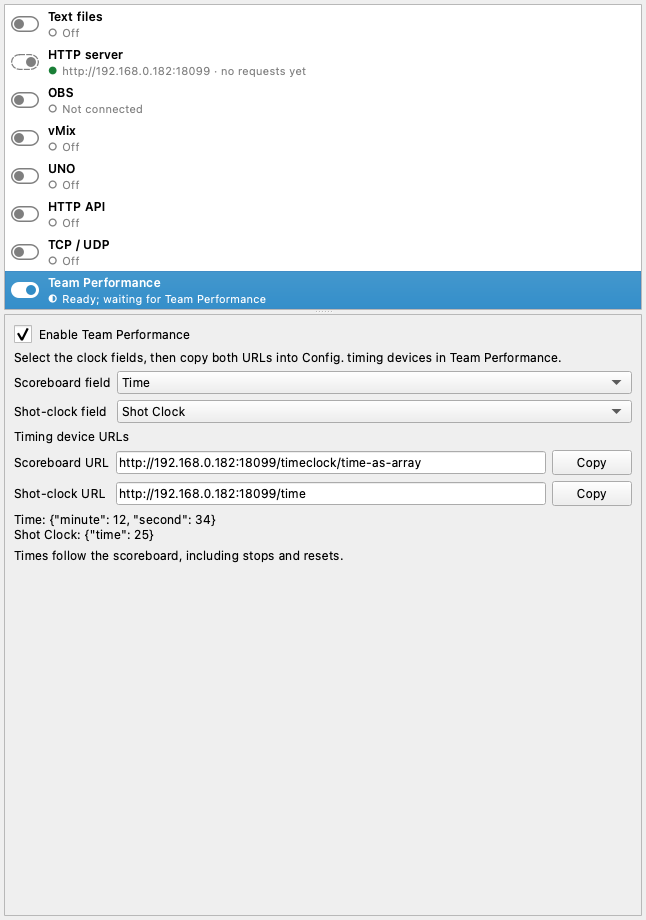

# Team Performance

Team Performance records goals and other match events for statistics. Its **Config. timing devices** function reads the scoreboard and shot clock from two HTTP URLs. ScoreSight can serve both directly: no `bridge.py`, extra Python process or additional server port is needed.

## Set up ScoreSight

1. Place OCR boxes over the match clock and shot clock. The default box names are **Time** and **Shot Clock**. Confirm that the readings follow the board, including stopped clocks, resets and zero.
2. In **Outputs**, select **Team Performance**. Choose the **Scoreboard field** and **Shot-clock field** if your boxes have different names.
3. Turn on **Enable Team Performance**, or use its switch in the Outputs list. The selection and switch are saved with your ScoreSight settings.
4. Copy the two URLs from the page. The page uses the computer's LAN address when available and the running HTTP server's port (normally **18099**). On the same computer, `127.0.0.1` also works. A live JSON preview shows each clock's available payload.

For a ScoreSight computer at `192.168.0.182`, with the default port:

| Device | URL | Example response |
|---|---|---|
| Scoreboard | `http://192.168.0.182:18099/timeclock/time-as-array` | `[{"minute":12,"second":34}]` |
| Shot clock | `http://192.168.0.182:18099/time` | `{"time":25}` |

Use the address of the computer running ScoreSight. These are URLs **provided by ScoreSight**, to enter in Team Performance; they are not remote destinations to enter in ScoreSight. The copy buttons provide the current address, and existing HTTP endpoints keep working.

## Connect Team Performance

Click **Config. timing devices** in Team Performance. In its console, enter the **scoreboard URL first**, then the **shot-clock URL**. Check that the times appear in the console and on the configuration button. The configuration is normally saved by Team Performance; use the same button to change or disconnect the devices. Stream Deck controls are unavailable during that configuration process.

These instructions follow page 11 of the supplied *Handleiding KNKV Team Performance 1.9.x*, v1.7 (18 March 2026), and the timing JSON contract supplied for this integration. Verify the connection with your installed Team Performance version before using it during a match.

## Formats and clock behaviour

- The scoreboard returns integer `minute` and `second` values. ScoreSight accepts `mm:ss`, `mm:ss.d`, sub-minute `ss.d` / `ss,d`, bare seconds below 60 and its `ss:d` display format. Match-time fractions are discarded, not rounded (`0:09.9` becomes `{"minute":0,"second":9}`). Minutes up to 999 are supported.
- The shot clock returns numeric `time` in seconds, retaining fractions (`9.8` becomes `{"time":9.8}`). Zero and resets to 25 are valid. Values from 0 through 99 are accepted, so the output can also serve boards using other shot-clock durations.
- No timer is calculated or extrapolated. The output follows the displayed time, including stops during effective playing time. Two halves of 25 minutes, four periods of 10 minutes, and other match lengths need no timing configuration here.
- Only the timing keys are sent. Optional period, scores and running flags are omitted; the output does not infer whether the clock is running.
- The timing output uses the same last good OCR readings as `/json?pivot&all`. A temporary failed or empty reading keeps the last good value. That value may remain while a source is stopped or disconnected; it is not proof that the camera is still reading. A removed box, an explicitly cleared value, an invalid time or a clock with no good reading returns **HTTP 503** for that device, never an invented zero. The other device continues independently.
- **Pause outputs** freezes the served readings, and **Hold value** applies to these endpoints like the other HTTP outputs. Disabling Team Performance returns HTTP 503 from its endpoints, while the other HTTP outputs stay available.
- Responses are JSON with caching disabled.

## Object and array endpoints

Team Performance selects its parsing mode from the URL path: a path containing `array` returns an array with one object. All variants below are available on the same HTTP port:

| Path | Response shape |
|---|---|
| `/timeclock/time-as-array` | `[{"minute":12,"second":34}]` |
| `/timeclock/time-as-object` | `{"minute":12,"second":34}` |
| `/time` | `{"time":25}` |
| `/time-as-array` | `[{"time":25}]` |

## Replacing bridge.py

Stop the old bridge, enable the built-in output, and replace port **18100** with **18099** in Team Performance's stored URLs. The paths above are compatible with the supplied bridge. If you intentionally start ScoreSight with `--port 18100`, the old URLs can remain unchanged, provided the bridge has stopped and that port is free. Changing ScoreSight's HTTP port also changes its other HTTP URLs.

If Team Performance cannot connect, open each URL from the Team Performance computer. Check the address and port, the output switch, that both OCR fields have valid readings, and that the network/firewall allows connections to ScoreSight's HTTP port. The Outputs status reports a stopped server or missing readings, and records when a timing URL was requested. A request means a client polled the URL; it does not confirm that Team Performance accepted or used the value.
