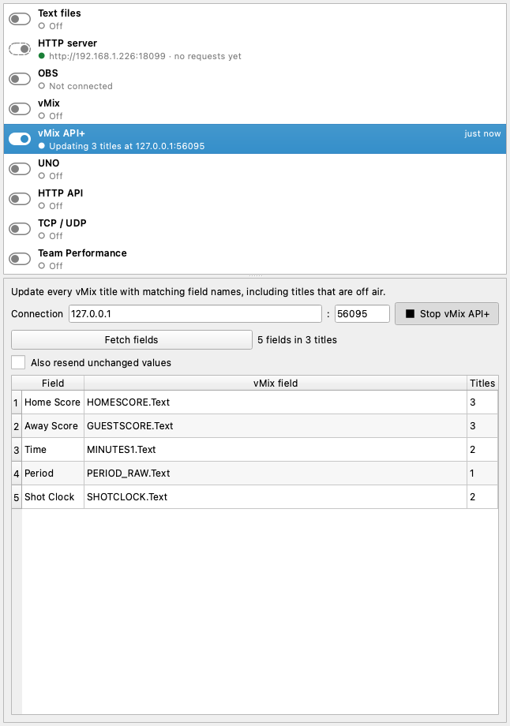

# vMix API+

Use **vMix API+** when several graphics share the same scoreboard data. For example, a live scorebug, a half-time graphic and a time-out graphic can all contain `HOMESCORE.Text` and `GUESTSCORE.Text`. One ScoreSight mapping updates the field in **every matching vMix input**, whether or not that graphic is currently on air. Switching graphics does not require changing ScoreSight's input selection.

The existing [vMix output](vmix.md) targets one input. API+ is a separate output with its own connection, mappings and resend setting. You can use either; avoid mapping the same fields through both outputs to prevent duplicate writes.

## Set up vMix

Enable vMix's **Web Controller** / API, normally on port **8088**, as described in [vMix: Enable the Web Controller](vmix.md#1-enable-the-web-controller-in-vmix). ScoreSight needs API access without a login. Port **8099** is the TCP API and is not used by this output.

Load the graphics you want to keep updated in the current vMix preset. In the **Title Editor**, give their text fields the same names wherever the values should be shared. Use the exact names shown there, including `.Text` for GT titles. Only matching text fields receive data; images and similarly spelled names are not changed.

## Configure ScoreSight

1. Select **vMix API+** in **Outputs**, directly below **vMix**.
2. Enter the vMix computer's host/IP address and Web Controller port. Use a host such as `192.168.0.197`, not a full URL. Press Enter or leave the field to apply a connection change.
3. Click **Fetch fields** to read the title fields from vMix. This works while the output is stopped and does not send any text.
4. In each mapping row, double-click the **vMix field** cell and select a discovered name, or type one. Clear a cell to stop sending that ScoreSight field. The **Titles** column shows how many inputs currently contain that name.
5. Click **Start vMix API+** or enable its switch in the Outputs list.

Example mappings (these are your title names, not mandatory vMix names):

| ScoreSight field | vMix field | Result |
|---|---|---|
| Home Score | `HOMESCORE.Text` | Updates every title containing `HOMESCORE.Text` |
| Away Score | `GUESTSCORE.Text` | Updates every title containing `GUESTSCORE.Text` |
| Time | `MINUTES1.Text` | Sends the complete Time value, for example `5:58` |
| Period | `PERIOD_RAW.Text` | Sends the Period value |
| Shot Clock | `SHOTCLOCK.Text` | Sends the Shot Clock value |

API+ copies each field's text as read; a name such as `MINUTES1.Text` does not split a clock into minutes and seconds. If a title needs separate parts, use suitable ScoreSight fields or template fields.

Connection settings, mappings and **Also resend unchanged values** are saved. Sending starts only when you turn the output on. **Stop vMix API+** stops sending and automatic discovery, keeping the configuration.

## Switching and adding graphics

While running, API+ refreshes the list of vMix title fields every **five seconds**. Input GUIDs identify titles, so moving an existing input to another input number does not redirect its updates.

A newly found title receives the last good published value of each matching field, even when that value is unchanged. There may be up to five seconds before an added title is discovered; **Fetch fields** requests a refresh immediately. Existing titles continue receiving changed readings as they happen. All graphics must be loaded as inputs in the current preset to receive updates.

This discovers all matching inputs, not just the active/preview graphic. Keep unrelated titles' field names distinct if they should not receive scoreboard data.

## Readings and status

- Good readings (`Success` / `SameNoChange`) supply the current values. Failed or empty OCR readings keep the preceding good value. An explicitly cleared value sends an empty string.
- By default existing titles receive changed readings; **Also resend unchanged values** also sends `SameNoChange` readings on every cycle. Discovery does not rewrite every existing title on each refresh.
- **Pause outputs** freezes the published values, and **Hold value** reaches API+ through the same output pipeline as the other destinations. A newly discovered title receives the last published value, which remains frozen during a pause.
- Discovery and sending run in the background, with the standard output timeouts and retry/backoff behaviour. A rejected field in one title does not block delivery to other titles. If the vMix server is unreachable, the newest queued values are retained for retry.
- The output row shows the number of matching titles, missing mapped field names, discovery errors and delivery errors. **Titles** counts discovered matches; a successful delivery status additionally requires a successful `SetText` request.

If a mapped name has no matches, confirm the exact spelling and suffix in vMix's Title Editor, then click **Fetch fields**. If fetching fails, check the host, port, API access and network connection. Existing field choices and mappings are preserved when discovery temporarily fails.

## Protocol and validation

Discovery reads `GET http://<host>:<port>/api/` and parses the `<inputs><input key="…"><text name="…">` entries in vMix's state XML. Each destination receives its own `SetText` request with the input GUID, exact field name and percent-encoded text. See the [official vMix Web API documentation](https://www.vmix.com/help28/DeveloperAPI.html).

Automated tests use a local vMix API simulator with multiple titles, reordered/added/removed inputs, invalid XML, per-title errors and connection changes. A live vMix check is still required before relying on this new output during a match.
