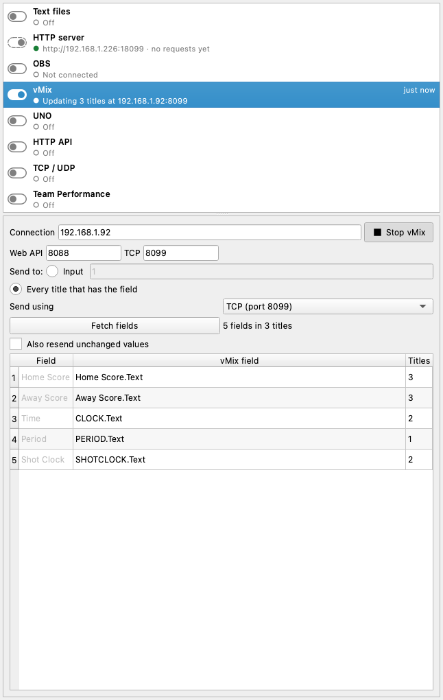

# vMix integration

The **vMix** output can update one title input, or every loaded title that contains a mapped field name. A scorebug, half-time graphic and time-out graphic can share the same scores and clocks even while off air. Both target modes share one connection, mapping table, resend setting and on/off switch.

## 1. Enable the vMix APIs

In vMix **Settings > Web Controller**, enable the Web Controller/API. Its HTTP port is normally **8088**. Allow API access without login; ScoreSight does not send a vMix username/password. Check the network/firewall permits the ports you use.

| Connection | Purpose |
|---|---|
| **Web API port**, normally **8088** | Fetch title fields, and send values when **HTTP** is selected |
| **TCP port**, fixed **8099** | Send values when **TCP** is selected |

The port you type in **Web API** must be the HTTP port, including when you send values over TCP. The separate **TCP** box shows 8099 and cannot be edited. With HTTP selected, only the Web API port is needed. With TCP selected, both ports must be reachable on the same vMix computer; successful field discovery alone does not confirm TCP connectivity.

ScoreSight 0.1.x and older incorrectly defaulted the Web API port to 8099. The one-time migration of that old setting to 8088 is retained; a port you set later is kept.

## 2. Prepare the vMix title fields

Load the graphics as inputs in vMix. In the **Title Editor**, note their exact text-field names, including `.Text` for GT titles. For example:

| ScoreSight field | vMix field |
|---|---|
| Home Score | `Home Score.Text` |
| Away Score | `Away Score.Text` |
| Time | `CLOCK.Text` |
| Period | `PERIOD.Text` |
| Shot Clock | `SHOTCLOCK.Text` |

Names are case-sensitive and spaces matter. Only fields with the exact mapped name are updated. To share data across graphics, give their corresponding text fields the same name. Use different names for unrelated fields that should not receive scoreboard data.

The repository's [`scoresight.vmix`](https://github.com/royshil/scoresight/blob/main/scoresight.vmix) preset provides a starting scoreboard title.

## 3. Configure the vMix output

Select **vMix** in **Outputs**, or click **vMix** in the status bar.

1. Enter the vMix computer's host/IP, such as `192.168.1.92`, or `localhost` if it runs on the same computer. Enter its Web API port, normally 8088. Press Enter or leave the field to apply a connection edit.
2. Under **Send to**, choose:
   - **Input**: enter its number, full title name or GUID. Only that input receives values. The field list and **Titles** counts refer to the selected input.
   - **Every title that has the field**: every loaded title with an exact field-name match receives the value, including titles off air. No input number is needed. **Titles** shows the number of matching inputs for each field.
3. Choose **Send using**: **HTTP (Web API port)** is the existing default. **TCP (port 8099)** uses a persistent connection and acknowledges each command. This setting is shared between both target modes.
4. Click **Fetch fields** to discover the available text-field names. Double-click a mapping cell and select a name from the dropdown. You can also type a name manually, which allows configuration before vMix is available. Manual mappings are retained if a fetch fails; fetching never renames or overwrites them. Clear a cell to stop sending that field.
5. Click **Start vMix**, or turn on the vMix switch in Outputs. The button changes to **Stop vMix**. Stop keeps the settings.



**Also resend unchanged values** sends `SameNoChange` readings on every detection cycle as well as changed readings. This is useful if title values might also be changed by hand in vMix. With it off, existing titles get changed values. Newly discovered titles receive the last good published values even if those values are unchanged.

The initial default mapping is the ScoreSight field name. It often needs the exact vMix spelling and `.Text` suffix; selecting a fetched name avoids typing those manually. Existing host, port, input and mappings remain usable, with **Input / HTTP** as the default. Sending starts only when you turn it on.

## When are fields fetched?

The title list is fetched:

- on **Start vMix**;
- after changing the connection while the output is running;
- on **Fetch fields**, also while stopped.

There is **no periodic XML polling**. The list is cached, so changing between target modes or selecting another input can reuse it. After loading, removing, renaming or changing titles in vMix, click **Fetch fields** to refresh the list. A new matching title then receives the available last good values. Failed network requests may retry with backoff; a healthy connection does not keep re-reading the preset.

Discovery uses input GUIDs, so reordering existing inputs does not redirect all-title updates. The counts and dropdown reflect the last fetch, not a continuous connection monitor. Input mode also accepts vMix's special input selectors `0` (Preview) and `-1` (Active); refresh the field list after changing what those selectors refer to.

## Readings, errors and performance

Good readings (`Success` and `SameNoChange`) supply the cached values. Failed/empty readings keep the last good value. An explicitly cleared value sends empty text. **Pause outputs** freezes published values, and **Hold value** applies to this output like the others.

Discovery and sending run in background workers. Pending sends keep the newest value per input/field. A rejected field does not block other titles. If the receiver is unreachable, unsent values are retried with backoff. Stopping or changing the connection cancels obsolete queued work.

The output row reports delivery and errors. In all-title mode it also reports matching title counts and missing names. Discovery errors identify the Web API endpoint; TCP send errors identify the TCP endpoint. **Titles** counts discovered matches; successful delivery additionally requires a successful HTTP response or TCP acknowledgement.

vMix documents lower processing overhead for its TCP API. No measured HTTP-versus-TCP latency advantage is claimed here: use the transport that suits your production and available ports.

## Protocol

Field discovery reads `GET http://<host>:<web-port>/api/` and parses vMix's input and text-field XML. It supports both one-input filtering and all-title matching.

HTTP updates use percent-encoded `SetText` requests:

```text
http://<host>:<web-port>/api/?Function=SetText&Input=<input>&SelectedName=<field>&Value=<value>
```

TCP updates use one persistent connection to `<host>:8099` and UTF-8, CRLF-terminated commands:

```text
FUNCTION SetText Input=<input>&SelectedName=<field>&Value=<value>
```

Parameters use percent encoding. ScoreSight waits for `FUNCTION OK` or `FUNCTION ER` before sending the next command, handles the greeting and interleaved events, and reconnects after a disconnect or timeout. A rejected command does not close a healthy connection. There is no silent transport fallback.

References: [official vMix Web API](https://www.vmix.com/help30/DeveloperAPI.html) and [official vMix TCP API](https://www.vmix.com/help30/TCPAPI.html).

## Alternative: vMix Data Sources

Instead of the direct integration, you can feed vMix titles from ScoreSight's HTTP server or files with vMix **Data Sources** (**Settings** > **Data Sources**, then bind title fields in the Data Source's mapping). vMix reads one row per poll and binds each column to a title field.

| Data Source type | URL or file | Notes |
|---|---|---|
| **XML** | `http://<scoresight-ip>:18099/xml?pivot&all`, XPath `/data` | One element per field: the names have no spaces (`HomeScore`, `AwayScore`) |
| **Excel/CSV** (from a URL or file) | `http://<scoresight-ip>:18099/csv?pivot&all`, with **first row as column names** | The columns are the field names (`Home Score`) |
| **JSON** | `http://<scoresight-ip>:18099/json?pivot&array` | vMix JSON Data Sources need an array of rows. `/json?pivot` returns a single object, which vMix doesn't read as a row; `?array` wraps it: `[{"Home Score": "21", ...}]` |
| **Text/CSV/XML file** | `results.csv` (or `results.xml`) from the [Text Files](text-files.md) output | `results.csv` has a `Timestamp` column first |

- Use `&all` (or the JSON `?array`, which includes it): every field is then always there with its last good value. Without it, a field whose reading is rejected for a moment is missing from that poll, and vMix may blank its title field.
- Set the Data Source's refresh interval to 250–500 ms.

These setups are **untested**: they follow vMix's documentation (and, for JSON, a vMix forum answer saying it needs an array). The direct integration above sends each change as it happens, and is the one we recommend.

## Troubleshooting

- **Fields cannot be fetched:** check the host and Web API port, API access and network. Input mode's HTTP sender can still use manually entered mappings if discovery is unavailable.
- **Fields are found, TCP updates fail:** check access to TCP port 8099 on that same computer. HTTP and TCP have independent connectivity.
- **Mapped name not found / count is zero:** check spelling, case and `.Text` in the Title Editor, then Fetch fields. Input mode lists only the selected input's fields.
- **New title does not update:** load it in the current preset and click Fetch fields. All-title mode uses the last fetched GUID/field list.
- **Some fields fail:** inspect the output row's error and compare mappings with the Title Editor. Failed or empty OCR readings are not new values to send.

Automated tests cover both targets with both transports against a local HTTP/TCP vMix simulator. The matching-title/TCP prototype has also been tested by the contributor against a real Windows vMix livestream computer, with two different graphics updating in Preview and Program. A full match-day production test is planned; the reshaped shared controls should be verified in the intended setup before relying on them during a match.
